# Experiment log

The full record of this project so far: what we tried, why, what each test showed, and what we
decided. Read it top to bottom. Every result table, figure and cluster log is in this repository;
["Where everything is"](#where-everything-is) at the end shows how to find them.

Numbers come from those saved tables. The few marked *(run log)* were only printed when the test
ran, so the table behind them doesn't show them directly.

## The short version

1. Our own deconvolution missed more than half of the true impulses, and its settings could not be
   chosen in a way that works for everyone. **Dropped.**
2. cvxEDA worked only when given the true response shape, which real data doesn't provide.
   **Dropped.**
3. The published Amin & Faghih (2021) solver passed our synthetic test. **Adopted**, unmodified.
4. Its weakness is that it always returns its built-in response shape, whatever the truth. When a
   person's true shape is far from that prior, about 46% of each response leaks into the baseline
   and sizes become unreliable. Real participants look like this mismatched case.
5. Every attempt to work around this failed its checks. **The prior stays**, and we report the
   problem instead of hiding it.
6. Adding the paper's missing preprocessing removes many false events, but it doesn't fix point 4.

**Status:** the pipeline is ready to freeze, pending the decisions listed near the end. Only 5 real
participants have been run so far, and nothing about our hypotheses has been tested yet.

## Terms

| Term | Meaning |
|---|---|
| τ rise, τ decay | How fast a skin conductance response rises and falls: the response *shape* |
| Prior | The solver's built-in preference for τ = 0.65 s rise, 2.77 s decay. It's inside the authors' encrypted code, so we can't change it |
| Tonic / phasic | The slow baseline / the fast responses on top of it |
| λ | Sparsity weight: higher means fewer impulses |
| F1, recall, precision | Scores for finding known impulses, matched one to one within 1 s. Recall: share of true impulses found. Precision: share of returned events that are real |
| Absorption | Share of each true response that the estimated tonic wrongly takes in (`phasic_taken`). Ideal is 0 |
| Prior / moderate / far groups | Synthetic sessions by true τ: drawn around the prior; 0.4/2.0 or 1.0/4.0; and 1.2/5.0 s (±10%) |

## Part 0: where we started

**Data.** We first looked at a POPANE free sample
([dataset check](dataset_check/README.md)) and at
[Study 5](../results/figures/study5_step2_raw_3participants.png), then settled on Study 6: 187
adults, a five-minute baseline, then six two-minute films in one of four sets.

**Screening.** The dataset authors' own flags plus our automatic criteria, fixed before any analysis,
removed 68 participants for electrode noise, missing data, or almost no responses. That left 119:
neutral 29, negative 29, positive 32, mixed 29. Details are in the [proposal](proposal_methods.md).

**Plan from the proposal.** Stage 1 deconvolves skin conductance into impulses. Stage 2 estimates a
hidden arousal state from those impulses. Hypotheses H1–H6 then test that state. Background reading
is in the [literature notes](literature_review_notes.md).

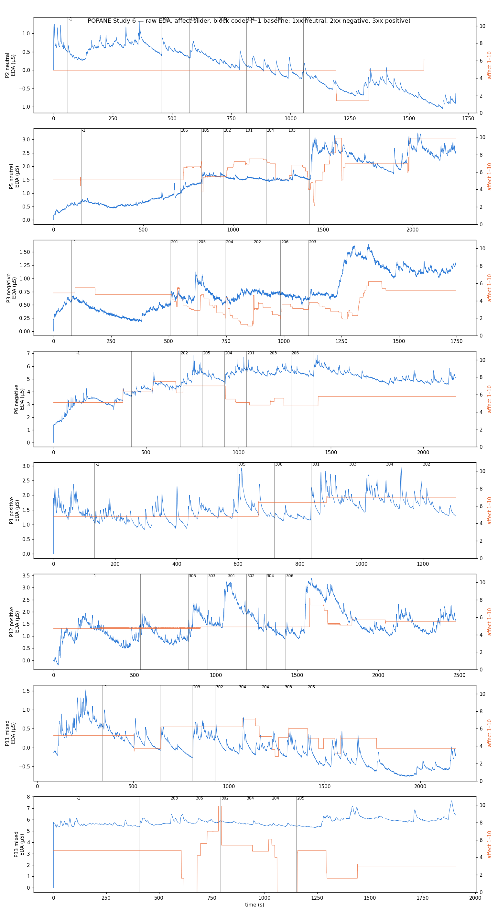

*Raw skin conductance (blue) and affect slider (orange) for 8 participants, two per group. Levels
differ widely and some signals go negative, which matters in Part 3.*

The first demonstration used our own method on one 120 s window:

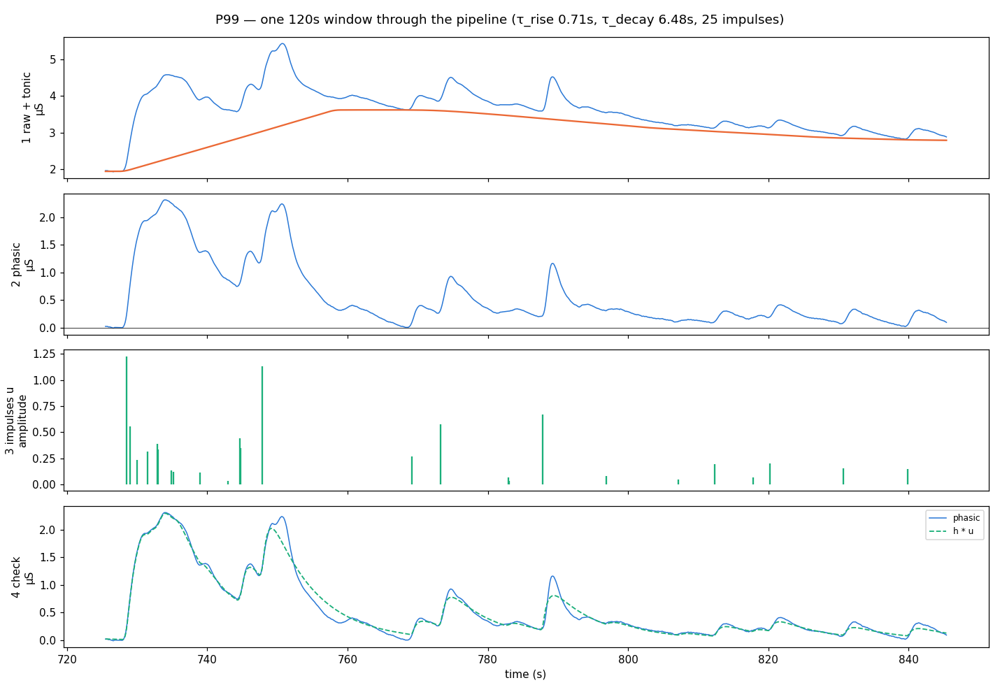

*P99 through our first pipeline: signal and tonic, phasic part, impulses, and the check that the
impulses rebuild the phasic part. Other participants:
[P5](../results/figures/study6_demo_P5.png),
[P6](../results/figures/study6_demo_P6.png),
[P34](../results/figures/study6_demo_P34.png).*

And stage 2 on a whole session:

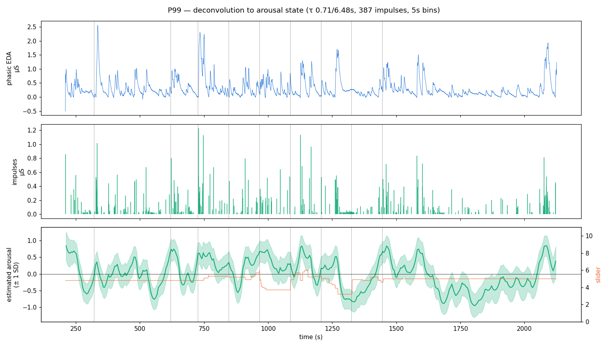

*P99 from impulses to estimated arousal, with the slider on the right axis. This is a demonstration
on one person, built on the deconvolution we later dropped. It tests nothing.*

## Part 1: our own deconvolution

**Method:** percentile baseline, L1 sparse deconvolution solved with FISTA, kernel fitted per
participant.

**Choosing λ.** We first chose λ by sweeping it until the impulse rate looked physiological, because
the fit barely changes with λ and so can't choose it. That gave λ = 1.6.

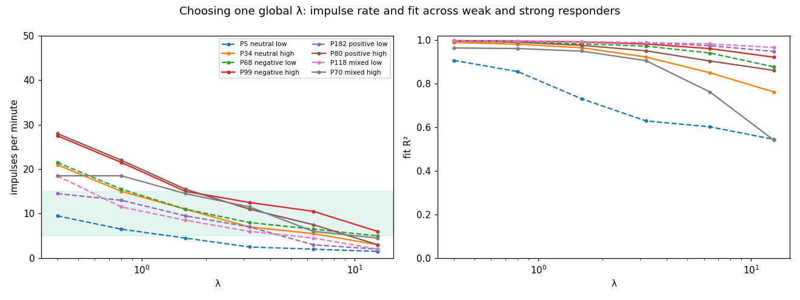

*Impulse rate (left, shaded = physiological range) and fit (right) across λ for 8 participants. The
[same sweep on P6](../results/figures/study6_lambda_sweep_P6.png) stays at R² 0.9 or above while
the rate falls from 44 to 10 per minute.*

**Fitting the kernel.** τ could not be fitted reliably per person: 42 of 119 participants had a τ
stuck at a limit.

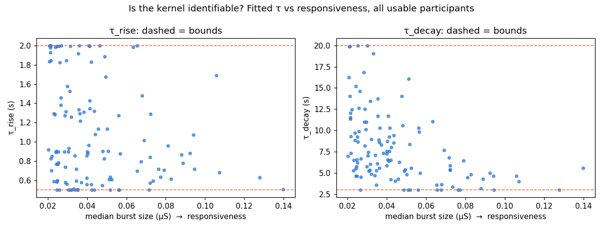

*Fitted τ across participants. Points on the dashed lines are stuck at a limit, and τ decay ranges
from 3 to 20 s.*

Then we built simulated sessions with a known answer and tested properly:

| Test | Result | Verdict |
|---|---|---|
| Fixed λ = 1.6, 20 sessions | Recall 0.42, precision 0.93, F1 0.58; τ decay 73% too long | Finds too few impulses |
| Sweep λ across burst sizes | λ giving the right τ decay: below 0.2 for 0.03 µS bursts, about 0.3 for 0.06, about 0.8 for 0.12 | No single λ works; a global λ would bias group comparisons |
| λ by GCV, as in the proposal | Picked the lowest grid value in 21 of 30 sessions; τ decay 39–47% too short for medium and large bursts | Failed |
| λ proportional to measured burst scale (`synth-scale`) | The scale measure didn't track true burst size, r = −0.1 *(run log)* | Failed |

**Verdict:** dropped. These tests also showed a pattern that kept returning: without outside
information, response shape can't be separated from the impulses.

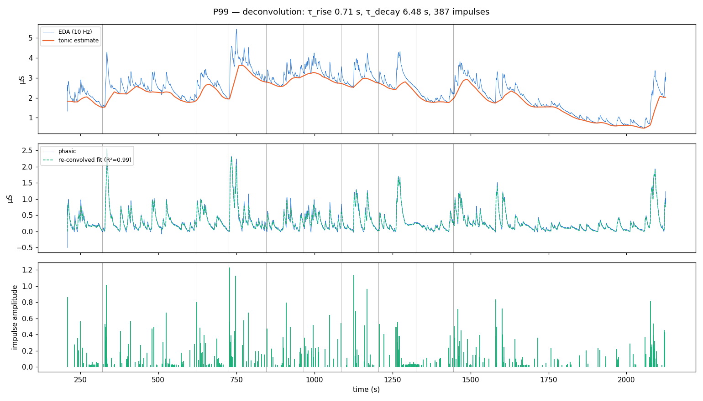

*Our method on all of P99: τ 0.71/6.48 s, 387 impulses, R² 0.99. Compare with cvxEDA in Part 2.
[P6, earlier settings](../results/figures/study6_deconv_P6.png).*

## Part 2: cvxEDA

Greco et al. (2016), authors' code unmodified.

| Test | Result | Verdict |
|---|---|---|
| Default settings, 20 realistic sessions | Recall 0.95, precision 0.25, F1 0.39 | Far too many false events |
| True τ, tuned α = 0.0128 | F1 0.74 | Good, but needs the true τ |
| τ found by an outer loop | τ decay ran to the 20 s limit; true median 8 s | τ cannot be identified from the data alone |

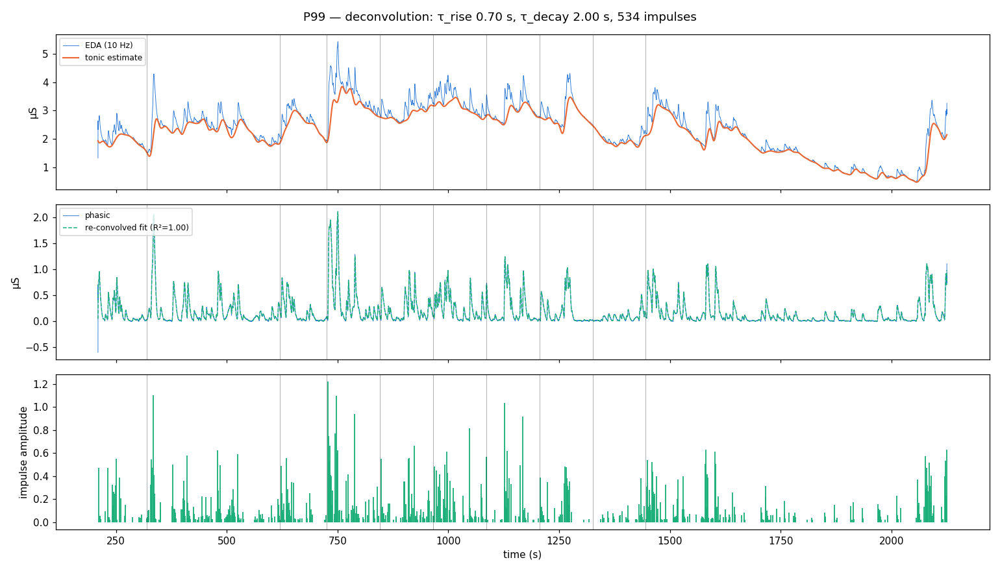

*cvxEDA defaults on the same P99: 534 impulses against our 387, R² 1.00, and a tonic that follows
the responses more closely. Same signal, very different answer, and both fit well. A good fit
doesn't tell you which is right.*

**Verdict:** dropped. The method needs a τ we don't have, so we moved to a method with
physiological priors on τ.

## Part 3: the published method

Amin & Faghih (IEEE TBME 2021). We run the authors' code unmodified on the Torch cluster, in the
form their scripts use: 2 Hz signal, 4 Hz impulses, 200 s windows every 100 s, τ limits
0.1–1.5 / 1.5–6 s.

First we checked it reproduces a sensible result on their own data: R² 0.994, τ 0.89/2.96 s
*(run log)*.

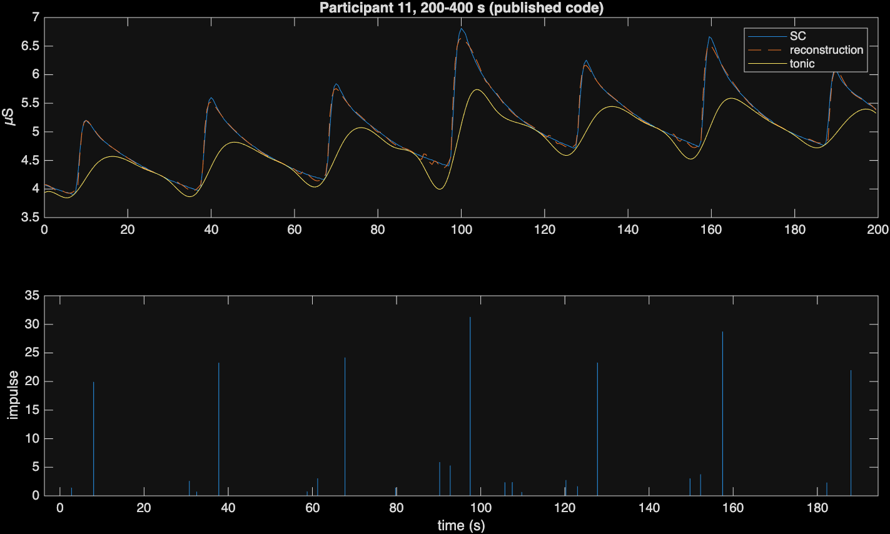

*The authors' code on their own participant. Notice the tonic (yellow) rising after each response
even here. Part 4 shows why that matters.*

Synthetic sessions are built from the profiles of the 119 usable participants: 36 sessions, 12 per
τ group. The earlier simulated sessions had τ decay of 4–12 s, far from the literature value of
about 2.8 s, so these were redrawn.

| Test | Result | Verdict |
|---|---|---|
| Pass rule set in advance: median F1 ≥ 0.7 in prior and moderate | F1 0.76 prior, 0.72 moderate, 0.65 far (far is reported, not required). Timing error about 0.17 s | **Passed. Adopted** |
| Negative signal values | τ decay varied 3.2 s between windows. A constant shift to a floor of 0 or 2 µS cut that to 0.014 s; F1 unchanged (0.69) | Shift if the minimum is below 0 |
| What are the false events? | 30% of returned events. Of those, 71% isolated, 25% duplicates, 3.5% off-time | Mostly small and isolated |
| Size cut-off, chosen on half and checked on the other half | Cut 0.5: F1 +0.05, precision 0.70→0.80, recall 0.79→0.71 | Kept then. Needs a re-check, see Part 5 |
| Merging close events | No held-out F1 gain *(run log)* | Rejected |
| "Pulse importance" score instead of size | Better AUC (0.83 vs 0.78), no better held-out F1 *(run log)* | Rejected |
| First 5 real participants (P53, P115, P26, P3, P80) | R² 0.991–1.000; 54 of 55 windows pass the authors' rule. Kept events vs SCRs counted directly: 1.20, 1.58, 1.91, 0.44, 1.21 times | Runs properly on real data |

Figures for those 5, unfiltered input: [P53](../results/figures/tbme_real_P53.png),
[P115](../results/figures/tbme_real_P115.png), [P26](../results/figures/tbme_real_P26.png),
[P3](../results/figures/tbme_real_P3.png), [P80](../results/figures/tbme_real_P80.png). They were
redrawn on Nov 3 from the same runs.

## Part 4: the τ problem

In all three groups the solver returned τ near 0.65/2.78 s, even in the far group where the truth
is 1.2/5.0 s. A good fit therefore doesn't mean the response shape was recovered.

| Test | Result | Verdict |
|---|---|---|
| Longer windows, 400 s | τ unchanged at about 80 minutes per window, mostly unconverged | Rejected |
| Faster sampling, 4 Hz | τ stayed at the prior; F1 fell in the 3 finished sessions (0.74→0.54, 0.76→0.69, 0.71→0.62); about 10× slower | Rejected |
| Does a wrong τ leave a mark in the pulses? | Tail pulses don't track the true decay, r = −0.18 | Rejected |
| How much does mismatch cost? | Absorption −1% prior, 9% moderate, 46% far | Far sessions lose sizes to the tonic |
| Do real participants look mismatched? | Fast share of tonic vs signal: 0.08 prior, 0.14 moderate, 0.38 far; real 0.27–0.56 | They look like far, or worse |
| Force τ to the truth by narrowing the limits | Far: F1 0.67→0.71, precision 0.70→0.80, size ranking 0.87→0.94, absorption 45%→19%. Prior: F1 0.76→0.88 | τ mismatch is a real cause, but not the only one: true τ still leaves 19% |
| Measure τ from single isolated responses | Synthetic passed (decay error 11%, rank 0.93, but only 15 of 36 sessions usable). Real failed: 0 of 5 accepted, because fits hit the limits | Failed |

## Part 5: preprocessing

Before going further, we checked that the real signals were being treated properly and compared
them with the synthetic ones.

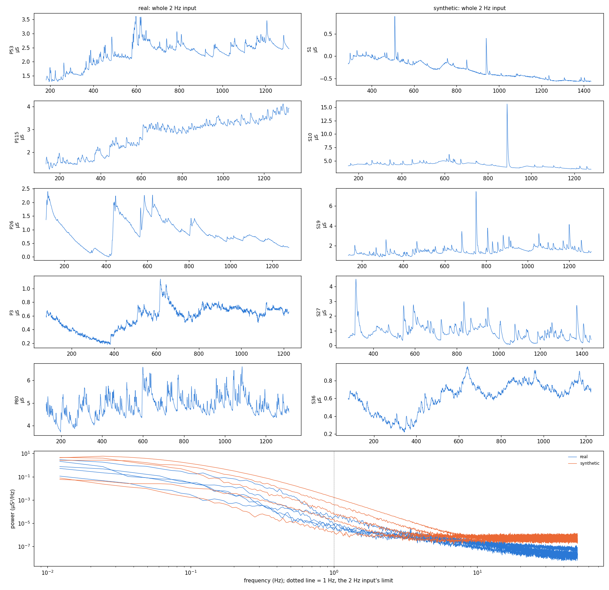

*Real (left) and synthetic (right) inputs, whole sessions, before the paper's filter, with their
spectra below. Noise matches (0.003–0.008 vs 0.005–0.007 µS). Synthetic sessions had oversized
spikes, up to 15 µS in S10 with jumps up to 2.98 µS against at most 0.11 µS in real data, so later
synthetic sessions cap response sizes. Before and after the 2 Hz step:
[real](../results/figures/preprocess_real.png),
[synthetic](../results/figures/preprocess_synth.png).*

We had been feeding the solver a plain 2 Hz sample of the signal. The paper's supplement (section C)
describes more: remove large jumps, fill them with a cubic B-spline, low-pass at 0.5 Hz, then
down-sample to 2 Hz.

**The published code doesn't do this.** The authors' published "preprocessed" file has no low-pass:
it has power all the way up to 50 Hz, and the file from their readme link is byte-identical to it.
Their scripts only call `downsample`. A cluster probe (`src/tbme/probe/`) showed that the solver
doesn't filter either. It logged every call to their filter function during one window, and there
were none:

```
largest |r.y - input| = 0 uS
probe finished: tau 0.665 / 2.777, 30 impulses
```

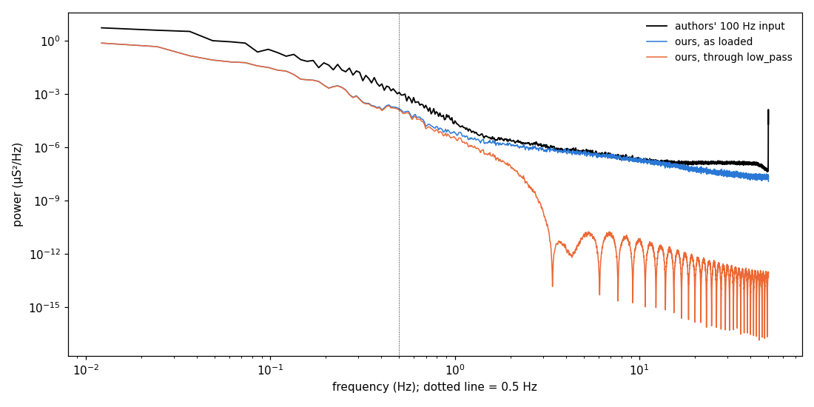

*Authors' file (black) against ours. Theirs keeps its power up to 50 Hz, so it wasn't low-passed.
The orange curve is our filter at order 64, before we changed to 640: it only starts falling hard
near 1 Hz, not at the dotted 0.5 Hz line, which is why we raised the order. This plot hasn't been
redrawn at order 640.*

**Our decision:** follow the supplement's text, since that is the stated method, and disclose the
mismatch. The paper gives no filter order, so order 640 is our choice. It comes from a calculation;
its response hasn't been plotted yet.

**Results,** 5 real and 8 synthetic sessions, median over 4 sessions per group:

| | Prior, before | Prior, after | Far, before | Far, after |
|---|---:|---:|---:|---:|
| F1 | 0.76 | 0.84 | 0.67 | 0.70 |
| F1 with the 0.5 cut-off | 0.78 | 0.78 | 0.67 | 0.68 |
| Precision | 0.77 | 0.94 | 0.70 | 0.87 |
| Recall | 0.82 | 0.76 | 0.70 | 0.57 |
| Size ranking (Spearman) | 0.95 | 0.94 | 0.87 | 0.84 |
| Timing error (s) | 0.20 | 0.32 | 0.16 | 0.25 |
| Absorption | | | 45% | 46% |

- Every window passed the authors' rule: 147 of 147, including P80's window that failed before.
- No session had a jump large enough to remove, so these changes come from the low-pass alone.
- Real participants: four of five moved closer to the directly counted SCRs (1.20→1.13, 1.58→1.46,
  1.91→1.50, 1.21→1.11), but P3 moved further away (0.44→0.37). The tonic's fast share didn't
  improve (0.35–0.64).
- One session got clearly worse: S24, F1 0.66→0.57.

**Verdict:** keep it, because it's the paper's method and removes false events. It works much like
the size cut-off and costs recall. It doesn't fix absorption.

Limits of this test: 8 synthetic sessions, and those sessions also had their largest responses
capped, so the change isn't due to filtering alone.

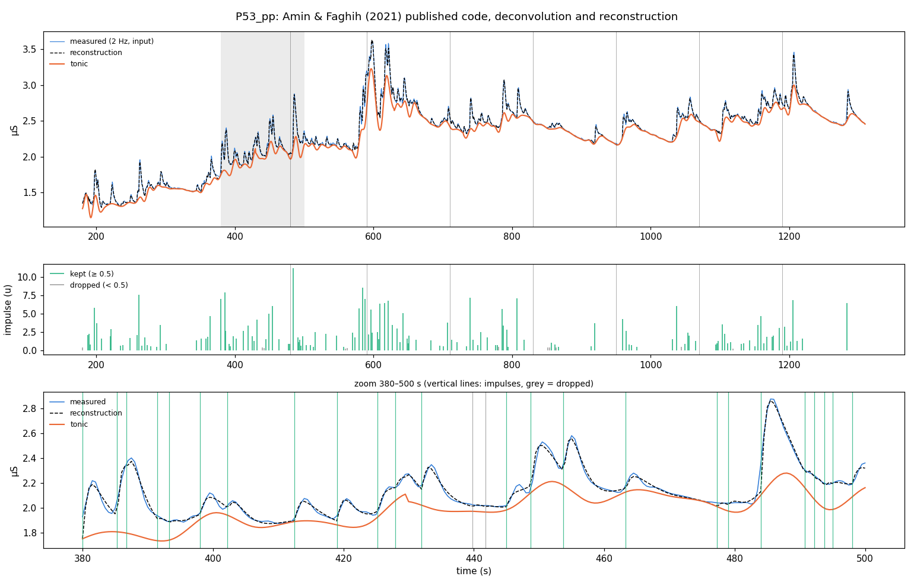

*P53 after preprocessing. The fit is excellent, yet the orange tonic rises into the responses. A
high R² doesn't rule out absorption.*

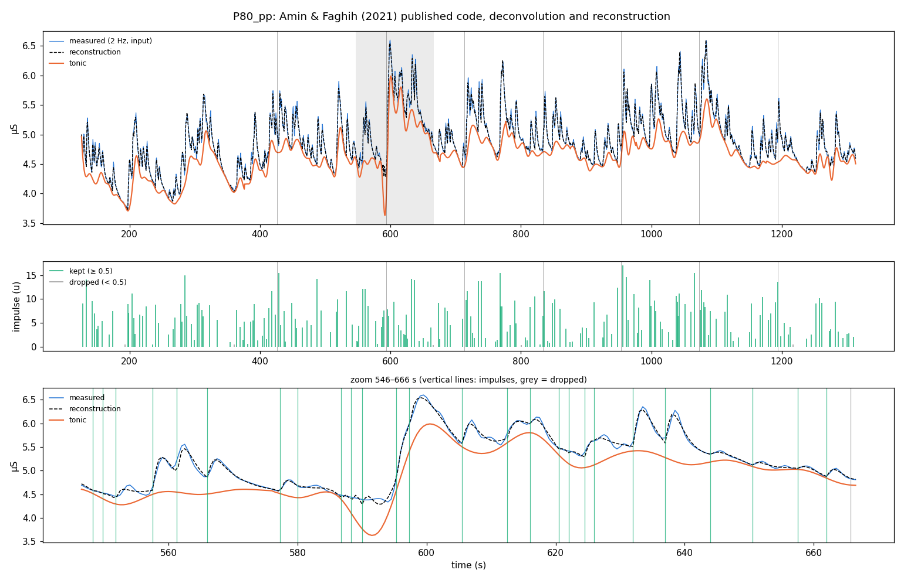

*P80, the noisiest of the five, where it's easier to see: the tonic follows most large responses,
and dips sharply near 590 s to fit the jump after it. Others after preprocessing:
[P115](../results/figures/tbme_real_P115_pp.png), [P26](../results/figures/tbme_real_P26_pp.png),
[P3](../results/figures/tbme_real_P3_pp.png).*

## Part 6: one τ per person (post-hoc retry)

One τ fitted across all of a person's isolated responses, with wider limits (rise up to 3 s, decay
up to 12 s). This was designed after seeing the Part 4 failure, so it must be disclosed as post-hoc.

| Check | Limit | Result |
|---|---|---|
| Decay error, known τ | ≤ 15% | **44%, failed** |
| Rank correlation | ≥ 0.7 | 0.73 |
| Far vs prior AUC | ≥ 0.9 | 0.95 |
| Real participants accepted | ≥ 3 of 5 | **1 of 5, failed** |

Rise and decay collapsed toward each other: about 2.1/2.4 s in far sessions whose truth is
1.1/4.9 s. The likely cause is measuring on the filtered signal, because filtering stretches the
rise. That explanation is untested.

**Verdict:** failed, and we stop here. Another attempt would be tuned to results already seen. The
prior stays.

## Current pipeline

Proposed for freezing; see "Decisions we need" below.

| Step | Source |
|---|---|
| Keep the baseline and films as one segment | Ours |
| Fill gaps by interpolation | Ours; the paper doesn't cover gaps |
| Remove jumps (prominence 0.1 on the absolute difference), cubic B-spline over a 0.5 s patch | Paper |
| Low-pass at 0.5 Hz | Paper; the order 640 FIR is ours |
| Down-sample to 2 Hz | Paper |
| Shift up if the signal goes below 0 | Ours |
| Authors' solver, unmodified, 200 s windows every 100 s | Paper |
| Lowest-residual converged start with τ rise off its limits | Authors' rule |

## What the report must disclose

- τ is set by the prior, so we won't report τ per person. Event timing and rate are more trustworthy
  than response sizes.
- The prior group is our best case and the far group our worst. Real participants resemble the
  worst case.
- 4 random starts per window, where the paper uses 8. Going to 8 would take much less than double
  the time, because starts run in parallel, but this hasn't been measured.
- The authors' published code and data skip the low-pass their supplement describes. We follow the
  supplement.
- Our additions: filter order 640, gap filling, the negative shift, a flagged fallback when no start
  passes their rule, and joining each output separately because their script builds all three from
  `y` by mistake.
- The shared-τ test (Part 6) was post-hoc and failed.

## Decisions we need

1. **Freeze the pipeline above?** Recommended: yes.
2. **Keep the 0.5 cut-off?** It was chosen on unfiltered inputs. After filtering, F1 is higher
   without it (0.84 vs 0.78 prior, 0.70 vs 0.68 far), so it likely needs to go or be re-chosen.
3. **4 or 8 starts?** 4 keeps these runs comparable with all the earlier ones.

## Next steps

1. Run `paper-check` again so the spectrum figure shows the order 640 filter.
2. Extend `paper-export` to all 119 participants. It currently covers the 13 test sessions.
3. Run all 119 on the cluster, about 15 minutes each, as a job array.
4. Move stage 2 onto these events. `state.py` still reads the archived deconvolution, and two older
   problems remain open: EM is unstable on one recording (`SR_FIXED` and `G1_MAX` are provisional),
   and 5 s bins lose impulses when a bin holds more than one.
5. Test the hypotheses:
   - H1: films raise arousal above rest.
   - H2: emotional films raise it more than neutral ones.
   - H3 (primary): arousal reflects intensity alone, so negative and positive both exceed neutral
     and don't differ.
   - H4 (the alternative): negative exceeds positive, within person, in the mixed group.
   - H5: emotions within a valence don't separate.
   - H6: the decoded state tracks the participant's own affect slider.
6. Write the report and slides, due November 25.

## Where everything is

| Part | Code | Result tables in `data/` | Cluster output |
|---|---|---|---|
| 0 | `dataset.py`, `quality.py`, `cohort_profile.py` | `quality_study6`, `profile_study6*` | |
| 1 | `archive/deconvolution.py`, `archive/experiments.py`, `archive/synthetic.py`, `archive/validation.py` | `synthetic_validation`, `_lambda_sweep`, `_fixes`, `_robustness`, `_gcv`, `_scale`, `kernels_study6` | |
| 2 | `archive/cvx.py`, `archive/validation.py` | `synthetic_cvxeda`, `_params`, `_alpha`, `_tau`, `cvxeda_real_configs` | |
| 3 | `tbme_export.py`, `tbme_synth.py`, `tbme_score.py`, `tbme_real.py`, `src/tbme/` | `tbme_synth_cohort`, `_check`, `_scores`, `_shift_scores`, `_false_events`, `_cutoff`, `_importance*`, `tbme_real_summary`, `tbme_input_shifts` | `hpc/synth/`, `hpc/real/output/`, `hpc/results/` |
| 4 | `tbme_score.py`, `tau_measure.py` | `tbme_synth_window400_partial`, `_rate_scores`, `_fixed_tau`, `tbme_tail_fingerprint`, `tbme_tonic_check`, `tbme_tau_measure`, `tbme_tau_responses` | `hpc/synth/` |
| 5 | `preprocess_view.py`, `tbme_export.py`, `src/tbme/probe/` | `preprocess_compare`, `paper_input_check`, `paper_input_spectrum`, `tbme_paper_test`, `tbme_paper_real` | `hpc/real/output_pp/`, `hpc/logs_pp/` |
| 6 | `tau_shared.py` | `tbme_tau_shared`, `tbme_tau_shared_responses` | |

**Cluster runs in `hpc/synth/output/`.** Each run has `_events`, `_windows` and `_signals` csv files.
Its name says what was tested:

| Name | Meaning | Part |
|---|---|---|
| `S4` | Session 4 as first run | 3 |
| `S4_m0`, `S4_m2` | Shifted to a floor of 0 or 2 µS | 3 |
| `S4_f4_w200` | Rebuilt at 4 Hz | 4 |
| `S9_t127_514` | τ forced to 1.27/5.14 s | 4 |
| `S9_t65_277` | τ forced to the prior | 4 |
| `S4_pp` | Paper's preprocessing | 5 |

`hpc/synth/logs*/` and `hpc/real/logs/` hold the slurm logs for these runs, and `hpc/results/` holds
the very first real run, P5 and P99, used as an engineering check. The ground truth for every
synthetic session is in `data/tbme_synth/`.
